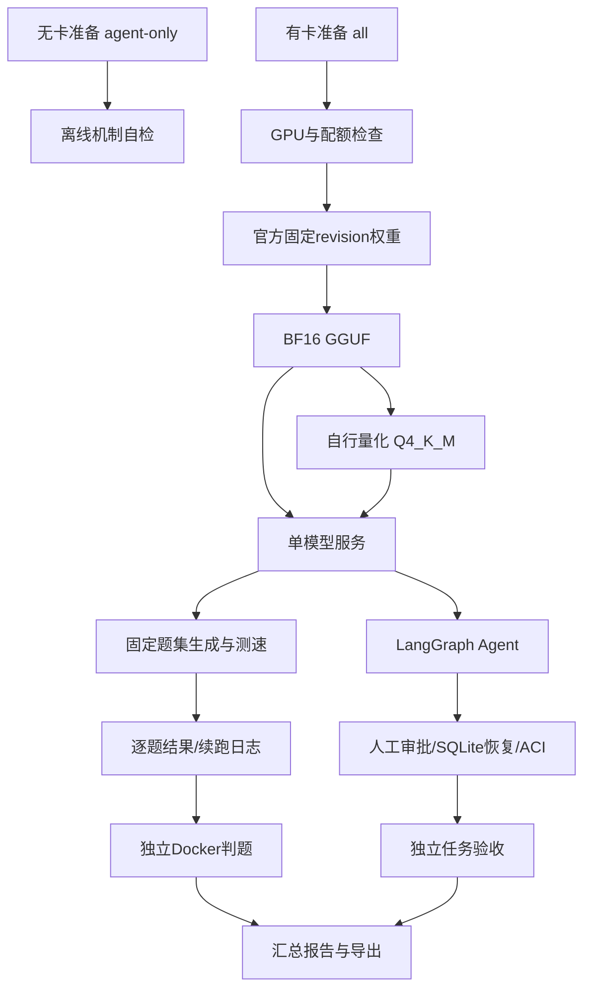

# 架构与数据流

- `readiness`只报告和检查资源。`models`负责来源、转换、量化和服务；工具链与Agent Python环境分离。
- `experiment`只编排固定矩阵并管理服务生命周期；具体生成和判题仍复用`evaluation`，不另造一套评测逻辑。
- `evaluation`将题目prompt发送给模型，将隐藏测试交给独立容器；生成和判题可以在不同机器完成。
- `agent`保存图状态，`aci`提供有界文件工具与幂等补丁，`sandbox`执行固定测试命令。Agent无法修改验收测试。
- `reporting`区分模型成绩、基础设施错误、Agent验收与待完成事项。`selftest`输出在独立offline目录，禁止混入真实成绩。

任务目录、实验矩阵与逐题写入均有独立锁或原子替换。恢复要求保持原运行配置；服务启动或执行失败会记录阶段错误并停止所启动的服务。清理模型必须显式指定，或在矩阵运行时启用cleanup-completed。
